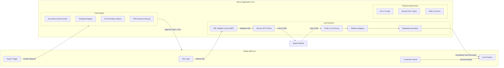
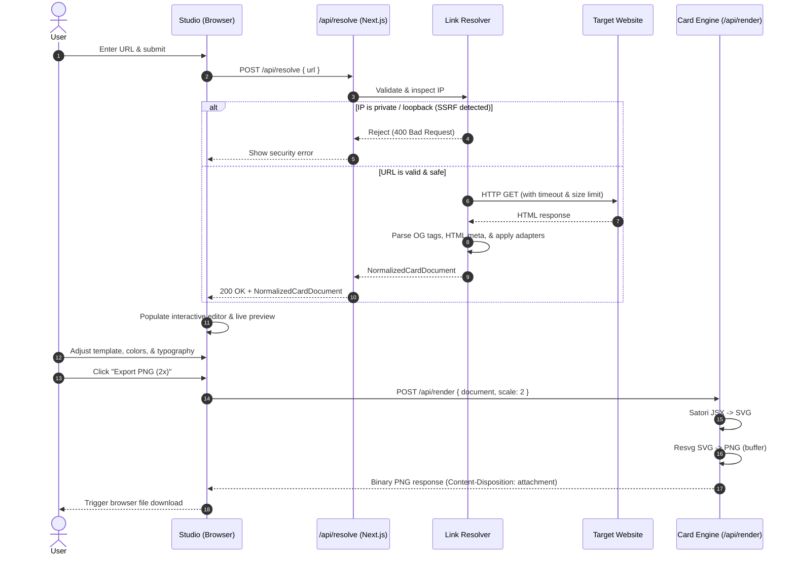

# Graphixl Architecture

This document describes the high-level architecture, module boundaries, security model, and data flow of **Graphixl**.

> [!NOTE]
> Graphixl is in its foundational development stage. This document outlines both the existing baseline foundation and the planned modular architecture to guide future feature development.

---

## 1. Architectural Principles

Graphixl is designed with four guiding principles:

1. **Simplicity:** A frictionless experience for users to convert URLs into high-quality visual cards without design expertise.
2. **Visual Quality:** Deterministic, pixel-perfect rendering with crisp typography, balanced spacing, and flexible aspect ratios suitable for diverse social platforms.
3. **Modularity & Extensibility:** Decoupled subsystems allowing templates, adapters, and renderer backends to evolve independently or be extracted as standalone packages in the future.
4. **Security by Design:** Comprehensive Server-Side Request Forgery (SSRF) defense, strict content sanitization, and resource consumption boundaries.

---

## 2. System Overview

Graphixl consists of four core logical subsystems:

---

## 3. Subsystem Breakdown

### 3.1 Link Resolver

The **Link Resolver** is responsible for taking an arbitrary user-submitted URL, validating and fetching it securely, and parsing it into a normalized metadata object.

#### Key Responsibilities

1. **URL Validation & SSRF Guard:**
   - Validates syntactical correctness and protocol constraints (only `http:` and `https:` allowed).
   - Resolves target hostnames via DNS and checks resulting IP addresses against prohibited subnets before executing requests.
   - Blocks private IP ranges (RFC 1918: `10.0.0.0/8`, `172.16.0.0/12`, `192.168.0.0/16`), loopback (`127.0.0.0/8`), link-local (`169.254.0.0/16`), IPv6 unique local (`fc00::/7`), and cloud provider metadata services (e.g., `169.254.169.254`).
   - Implements redirect-following guards that re-validate the target address at each redirect hop.

2. **Secure HTTP Retrieval:**
   - Configures sensible timeouts (e.g., 5-8 seconds max).
   - Implements maximum response body size limits (e.g., 2 MB) to prevent denial of service and memory exhaustion.
   - Emits an explicit User-Agent string identifying Graphixl as a preview generator.

3. **HTML & Open Graph Metadata Extraction:**
   - Uses Cheerio for fast, robust server-side DOM parsing.
   - Extracts standard Open Graph tags (`og:title`, `og:description`, `og:image`, `og:site_name`, `og:type`).
   - Extracts Twitter Card metadata (`twitter:title`, `twitter:description`, `twitter:image`, `twitter:card`).
   - Extracts fallback HTML metadata (standard `<title>`, `<meta name="description">`, `<link rel="icon">`, `<link rel="canonical">`).

4. **Provider-Specific Adapters:**
   - Extensible adapter pipeline to handle platforms with custom metadata structures or specialized content layouts (e.g., GitHub repositories, YouTube videos, Twitter/X posts, Substack articles, Medium posts).
   - Adapters enrich base metadata with domain-specific metrics (e.g., GitHub stars/language, YouTube channel name/runtime).

5. **Metadata Normalization:**
   - Outputs a unified, strongly-typed `NormalizedMetadata` schema across all input sources.
   - Cleans up truncated strings, decodes HTML entities, and resolves relative image URLs to absolute URLs.

---

### 3.2 Card Engine

The **Card Engine** is the visual generation core. It accepts a card document model, applies a selected template and style configuration, and renders either an SVG or a high-resolution raster image (PNG).

#### Key Responsibilities

1. **Card Document Schema:**
   - A declarative, strongly-typed Zod schema representing the complete card state:
     - Header: Site name, favicon URL, author name/avatar.
     - Content: Headline, summary excerpt, reading time, publication date, tags.
     - Media: Primary preview image URL, background image/gradient.
     - Style: Color palette (background, foreground, accent), font family, border radius, padding, aspect ratio.
     - Metadata: Source URL, timestamp.

2. **Template Registry:**
   - A registry of predefined, swappable card templates (e.g., *Editorial*, *Minimalist*, *Bold Gradient*, *Tech Accent*, *Split Showcase*).
   - Each template implements a unified interface taking the card document and returning a React element tree compatible with Satori.

3. **Aspect Ratio Presets:**
   - Pre-configured dimensions for common social and media formats:
     - **Square (1:1):** 1080 x 1080 px (Instagram post, feed).
     - **Story / Reel (9:16):** 1080 x 1920 px (Instagram / Facebook Stories, TikTok).
     - **Landscape (16:9):** 1200 x 675 px (Presentations, video cards).
     - **Social Share / OG (1.91:1):** 1200 x 630 px (Twitter, LinkedIn, Open Graph).

4. **SVG Rendering (Satori):**
   - Uses Satori to compile JSX elements into standard SVG vectors.
   - Bundles required web fonts (e.g., Geist Sans, Geist Mono, Inter) into font buffers for deterministic rendering across environments.

5. **PNG Export (Resvg):**
   - High-performance rasterization using `@resvg/resvg-js`.
   - Supports configurable scaling (e.g., 2x for Retina displays) to guarantee crisp output on high-DPI screens.

---

### 3.3 Studio

The **Studio** is the client-facing workspace where users interactively create and polish their cards.

#### Key Responsibilities

1. **URL Input & State Management:**
   - Input bar with URL validation, quick submit, and asynchronous fetch states (loading indicators, error handling).
2. **Live Previews:**
   - Instant visual feedback rendering the card in real-time as the user adjusts content or styles.
3. **Template Selection:**
   - Visual template picker allowing one-click template switching while preserving custom edits.
4. **Content Customization:**
   - Inline or panel-based editing for card title, description, author, publication date, and badge text.
   - Image swapping (choosing between detected OG images or custom uploads/fallbacks).
5. **Appearance Settings:**
   - Theme toggles (Dark, Light, System).
   - Color palettes, typography pairings, gradient options, and corner roundness sliders.
   - Aspect ratio switcher with responsive canvas preview.
6. **Export Actions:**
   - One-click export to PNG (standard or 2x resolution) and SVG.
   - Copy-to-clipboard functionality for direct pasting into social apps.

---

### 3.4 Shared Infrastructure

Common utilities and boundaries shared across the application:

1. **Validation:** Centralized Zod schemas for all network requests, API responses, and configuration schemas.
2. **Error Handling:** Standardized error hierarchy (`InvalidUrlError`, `SsrfBlockedError`, `FetchTimeoutError`, `ParsingError`, `RenderingError`) with structured JSON error responses.
3. **Configuration:** Type-safe environment variable management via `@t3-oss/env-nextjs`.
4. **Security Boundaries:** Strict separation of client and server logic, preventing external callers from triggering unchecked outbound requests.

---

## 4. End-to-End Processing Flow

The sequence diagram below outlines the full lifecycle of a card generation request:

---

## 5. Implementation Status

To maintain clarity for open-source contributors, the table below highlights current repository capabilities versus planned features:

| Component | Status | Details |
| --------- | ------ | ------- |
| Next.js App Shell | **Implemented** | Next.js 16 with App Router, Turbopack, React 19, TypeScript |
| UI Component Library | **Implemented** | shadcn Base Nova preset ejected in `app/globals.css`, Lucide icons |
| Tooling & CI | **Implemented** | pnpm, ESLint 9, TypeScript typecheck, GitHub Actions CI workflow |
| Dependencies Baseline | **Implemented** | Satori, `@resvg/resvg-js`, Cheerio, Zod, Framer Motion installed & verified |
| Link Resolver API | *Planned* | SSRF guards, HTTP retrieval, Cheerio parser, metadata normalization |
| Card Engine Core | *Planned* | Zod card schema, template registry, Satori SVG compiler, Resvg endpoint |
| Studio Interface | *Planned* | Interactive URL input, live preview canvas, customization side panel |
| Preset Templates | *Planned* | Curated library of responsive card templates across 4 aspect ratios |

---

## 6. Future Architectural Evolution

- **Standalone Package Extraction:** The Card Engine (`schema`, `templates`, `renderer`) is designed with no dependencies on Next.js server components or database layers. In the future, this can be factored out into an independent `@graphixl/core` or `@graphixl/engine` npm package without modifying the core rendering logic.
- **Monorepo Strategy:** While a single unified Next.js application repository is ideal during early development, the clear modular separation ensures that migrating to a monorepo (via Turborepo or pnpm workspaces) can occur when warranted by project scale.
