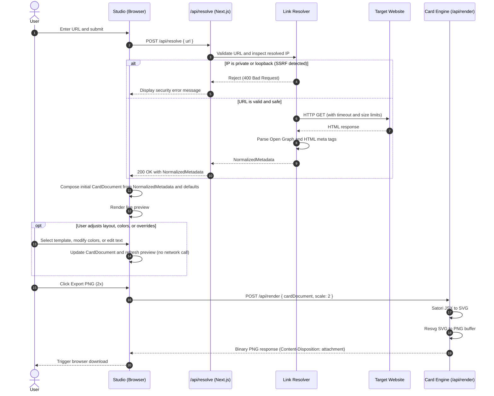

# Graphixl Architecture

This document describes the modular architecture, subsystem boundaries, data flow, and security model of Graphixl.

> [!NOTE]
> Graphixl is in its foundational development stage. This document outlines both the existing baseline foundation and the planned modular architecture to guide future development.

---

## 1. Architectural Principles

Graphixl is designed around four guiding principles:

1. **Simplicity:** An intuitive interface for converting URLs into quality visual cards without design expertise.
2. **Visual Quality:** Deterministic rendering with balanced typography, spacing, and aspect ratios tailored for common platforms.
3. **Modularity:** Decoupled subsystems allowing metadata extractors, templates, and renderers to evolve independently or be extracted as standalone packages.
4. **Defensive Design:** Strict validation against Server-Side Request Forgery (SSRF), content sanitization, and enforced request resource limits.

---

## 2. System Overview

Graphixl separates URL resolution, card composition, and image rendering into distinct subsystems:

```mermaid
flowchart LR
    subgraph Client["Studio (Browser UI)"]
        UI_Input["URL Input"]
        UI_Compose["Card Composition"]
        UI_Preview["Live Preview"]
        UI_Custom["Customizer Panel"]
        UI_Export["Export Trigger"]
    end

    subgraph Server["Next.js Application Core"]
        subgraph Resolver["Link Resolver (/api/resolve)"]
            Val["URL Validator & Anti-SSRF"]
            HTTP["HTTP Client"]
            Parser["HTML & OG Parser"]
            Adapters["Platform Adapters"]
            Norm["Metadata Normalizer"]
        end

        subgraph Engine["Card Engine (/api/render)"]
            Schema["CardDocument Schema (Zod)"]
            Registry["Template Registry"]
            SatoriRenderer["SVG Renderer (Satori)"]
            ResvgExporter["PNG Exporter (Resvg)"]
        end

        subgraph Shared["Shared Infrastructure"]
            Config["Env & Config"]
            Errors["Domain Error Types"]
            Utils["Utility Functions"]
        end
    end

    TargetSite["Target Website"]

    UI_Input -->|Submit URL| Val
    Val -->|Validated URL| HTTP
    HTTP -->|Fetch HTML| TargetSite
    TargetSite -->|Raw HTML| Parser
    Parser --> Adapters
    Adapters --> Norm
    Norm -->|NormalizedMetadata| UI_Compose

    UI_Compose -->|CardDocument| UI_Preview
    UI_Custom -->|Update Styling / Overrides| UI_Compose
    UI_Export -->|Render Request with CardDocument| Engine
    Engine -->|PNG / SVG Buffer| Client
```

---

## 3. Subsystem Breakdown

### 3.1 Link Resolver

The Link Resolver fetches a public URL safely and produces a structured `NormalizedMetadata` object. It operates independently from presentation and visual styling.

#### Key Responsibilities

1. **URL Validation and Anti-SSRF Protection:**
   - Restricts protocols strictly to `http:` and `https:`.
   - Resolves target hostnames via DNS and checks resulting IP addresses against prohibited subnets before issuing requests.
   - Blocks private IP ranges (RFC 1918: `10.0.0.0/8`, `172.16.0.0/12`, `192.168.0.0/16`), loopback (`127.0.0.0/8`), link-local (`169.254.0.0/16`), IPv6 unique local (`fc00::/7`), and cloud metadata services (such as `169.254.169.254`).
   - Validates each hop during redirect chains.

2. **HTTP Retrieval:**
   - Enforces request timeouts (such as 5 to 8 seconds).
   - Enforces maximum response body sizes (such as 2 MB) to mitigate memory exhaustion.
   - Uses an explicit User-Agent identifying Graphixl as a preview generator.

3. **HTML and Open Graph Parsing:**
   - Uses Cheerio for server-side DOM parsing.
   - Extracts Open Graph tags (`og:title`, `og:description`, `og:image`, `og:site_name`, `og:type`).
   - Extracts Twitter Card metadata (`twitter:title`, `twitter:description`, `twitter:image`, `twitter:card`).
   - Extracts fallback HTML metadata (standard `<title>`, `<meta name="description">`, `<link rel="icon">`, `<link rel="canonical">`).

4. **Platform Adapters:**
   - Optional domain adapters for services with specific metadata structures (such as GitHub, YouTube, or Substack).
   - Normalizes domain-specific fields into the standard metadata contract.

5. **NormalizedMetadata Schema:**
   The Link Resolver produces a typed `NormalizedMetadata` object containing:
   - `url`: Canonical source URL.
   - `siteName`: Extracted or derived website title.
   - `title`: Page headline or title.
   - `description`: Summary or excerpt text.
   - `imageUrl`: Primary preview image URL, resolved to an absolute address.
   - `faviconUrl`: Extracted favicon or touch icon URL.
   - `provider`: Detected provider identifier, if handled by a specific adapter.
   - `extra`: Key-value map for adapter-specific fields (such as repository star counts or author handles).

---

### 3.2 Card Composition and the Studio

The Studio manages user interaction and card composition in the browser.

#### Key Responsibilities

1. **URL Input and State Management:**
   - Accepts user input, initiates resolution requests, and tracks loading and error states.

2. **Card Composition:**
   - Combines `NormalizedMetadata` with user preferences to create a `CardDocument`.
   - Allows users to change templates, colors, typography, or content overrides without making additional network requests to the target website.

3. **Live Preview:**
   - Renders the card interactively in the browser to give immediate visual feedback.

4. **Appearance and Template Controls:**
   - Template selection (such as Minimal, Editorial, Split, or Bold).
   - Color palettes, typography presets, padding, and corner radii.
   - Aspect ratio selection.

5. **Export Triggering:**
   - Dispatches the composed `CardDocument` to the server rendering endpoint or initiates local downloads.

---

### 3.3 Card Engine

The Card Engine renders a `CardDocument` into standard visual assets (SVG and PNG). It has no dependency on the Link Resolver or external HTTP retrieval.

#### Key Responsibilities

1. **CardDocument Schema:**
   The `CardDocument` is a declarative Zod schema defining all data necessary for rendering:
   - `metadata`: Snapshot of normalized page information (title, description, site name, image URL, favicon URL).
   - `template`: Selected template identifier.
   - `aspectRatio`: Selected aspect ratio preset.
   - `customization`: User-defined overrides for headline, excerpt, author, accent color, background style, and fonts.

2. **Template Registry:**
   - Registry of swappable card templates.
   - Each template takes a `CardDocument` and returns a JSX element tree compatible with Satori.

3. **Planned Aspect Ratio Presets:**
   - **Square (1:1):** 1080 x 1080 pixels (Instagram posts and square feeds).
   - **Portrait (4:5):** 1080 x 1350 pixels (Instagram portrait posts).
   - **Story (9:16):** 1080 x 1920 pixels (Instagram Stories, TikTok, mobile vertical video).
   - **Landscape (16:9):** 1200 x 675 pixels (Presentations and landscape feeds).
   - **Social Share (approximately 1.91:1):** 1200 x 630 pixels (Open Graph, X, LinkedIn cards).

4. **SVG Rendering with Satori:**
   - Converts JSX elements and inline styles into SVG vector markup.
   - Injects embedded font buffers for consistent typography across platforms.

5. **PNG Rasterization with Resvg:**
   - Uses `@resvg/resvg-js` for deterministic SVG to PNG conversion.
   - Supports configurable scaling (such as 1x or 2x) for high-density exports.

---

### 3.4 Shared Infrastructure

1. **Validation:** Centralized Zod schemas for API requests, `NormalizedMetadata`, and `CardDocument`.
2. **Error Handling:** Standardized error hierarchy (`InvalidUrlError`, `SsrfBlockedError`, `FetchTimeoutError`, `ParsingError`, `RenderingError`) with structured JSON error responses.
3. **Configuration:** Environment variable parsing through `@t3-oss/env-nextjs`.
4. **Security Boundaries:** Strict isolation between untrusted client input and server-side HTTP execution.

---

## 4. End-to-End Processing Flow

The separation between `NormalizedMetadata` and `CardDocument` allows visual customization without redundant network requests:

---

## 5. Implementation Status

| Component | Status | Details |
| --------- | ------ | ------- |
| Next.js App Shell | Implemented | Next.js 16 with App Router, Turbopack, React 19, TypeScript |
| UI Component Library | Implemented | Warm neutral theme, Satoshi typography, custom SVG marks |
| Tooling and CI | Implemented | pnpm, ESLint 9, TypeScript typecheck, automated test suite, GitHub Actions CI |
| Link Resolver API | Implemented | Anti-SSRF DNS validation, safe redirect following, Cheerio extraction, GitHub adapter (`/api/resolve`) |
| Studio Interface | Implemented | Single-page UI on `/`, live responsive preview canvas, template and style controls, download triggers |
| Card Engine Core | Implemented | Declarative Zod schemas, Satori SVG compiler, `@resvg/resvg-js` PNG rasterization (`/api/render`) |
| Preset Templates | Implemented | Four distinct templates (Editorial, Minimal, Product, Repository) across 5 aspect ratios |

---

## 6. Future Architectural Evolution

- **Standalone Package Extraction:** The Card Engine is designed without direct dependencies on Next.js server components or database layers. It can be moved into a standalone `@graphixl/core` or `@graphixl/engine` package in the future without changing the core rendering code.
- **Monorepo Strategy:** During early development, maintaining a single unified Next.js application repository minimizes overhead. The modular separation between the Link Resolver and Card Engine ensures that transitioning to a monorepo structure will be straightforward when project scale calls for it.
